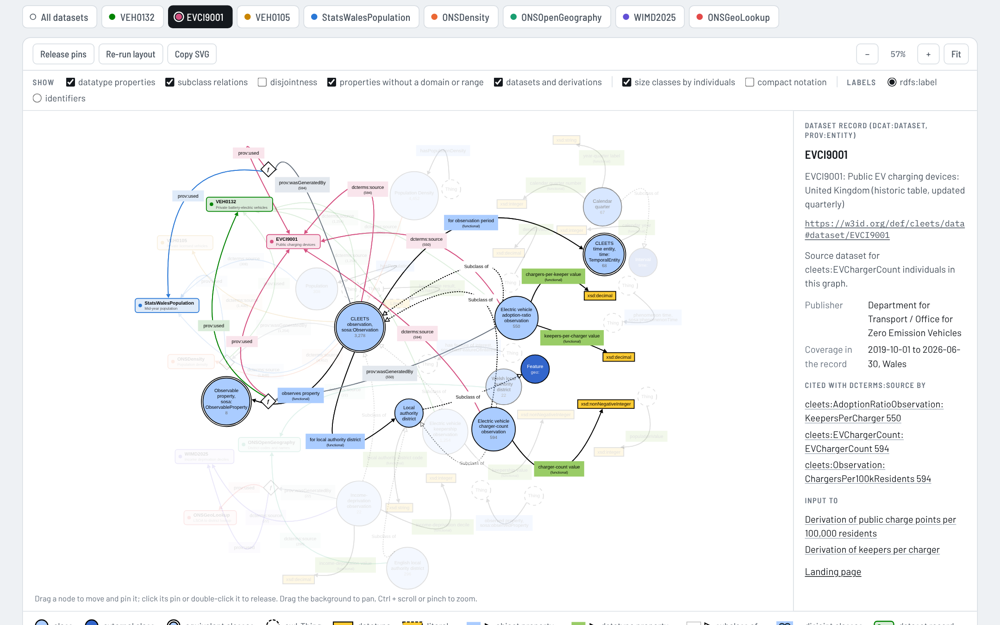
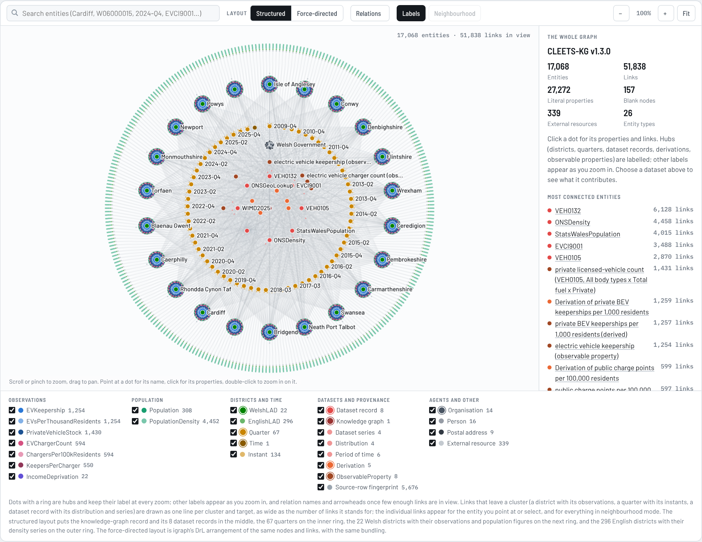
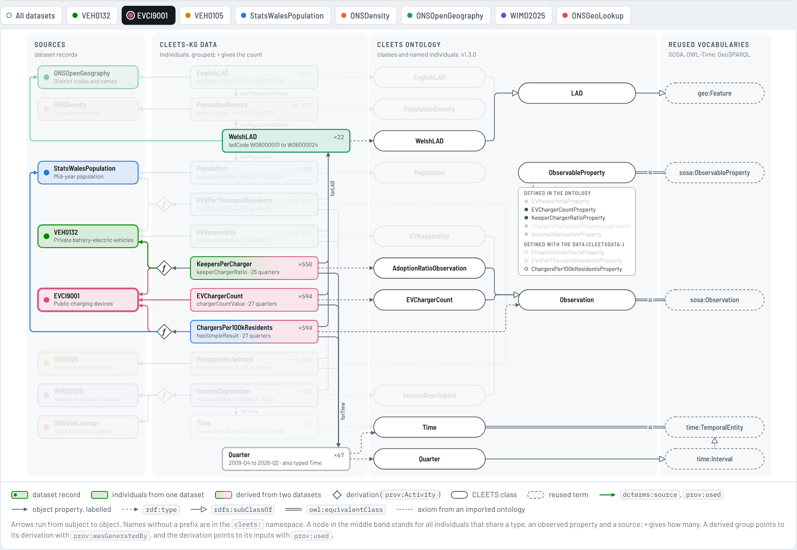
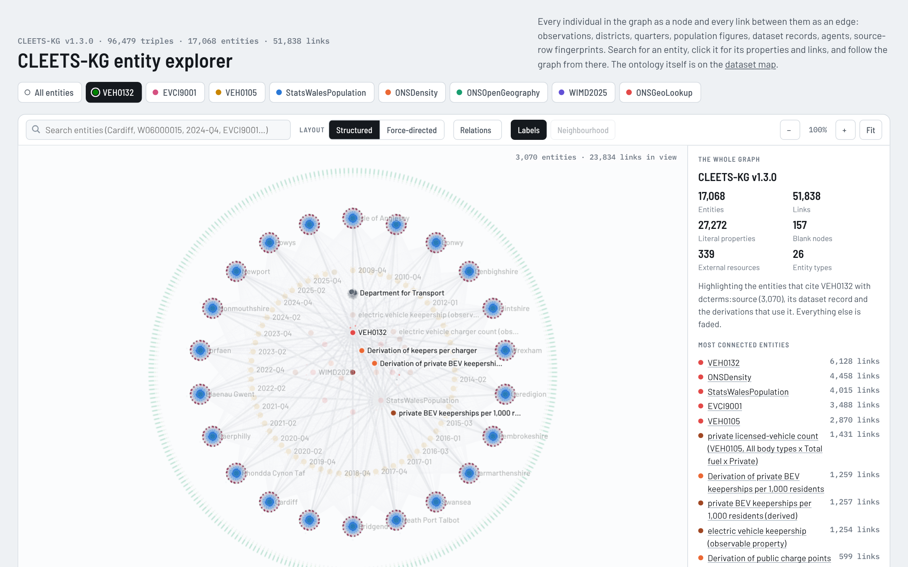
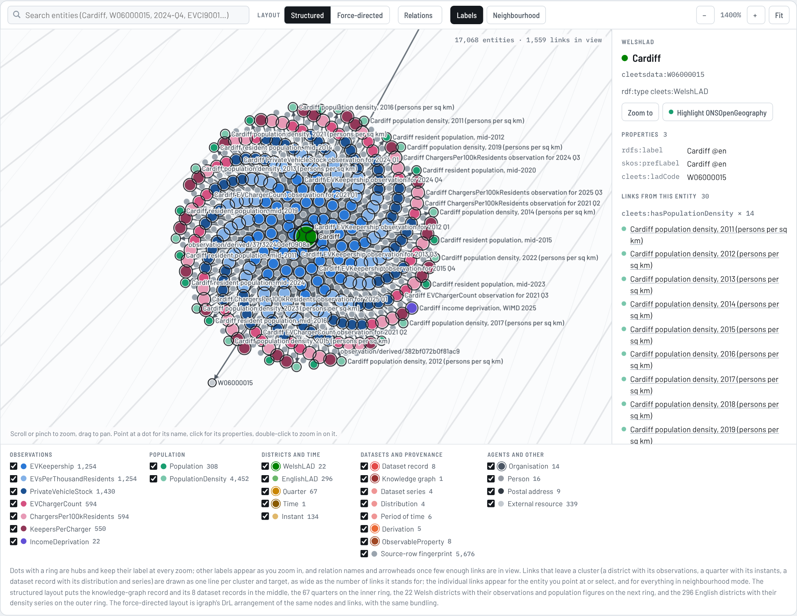
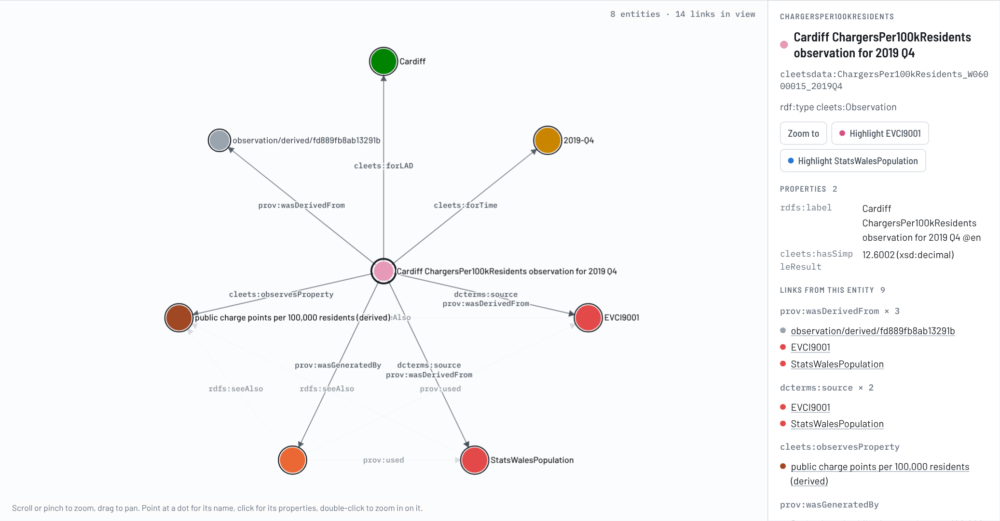

# CLEETS Knowledge Graph Visualisation

Two self-contained web pages that draw CLEETS-KG, the knowledge graph published as `index.ttl` in [Naeima/cleets](https://github.com/Naeima/cleets), from different distances. Both are generated from the Turtle file by the scripts in `build/`, so they can be regenerated whenever the graph changes, and both were cross-checked against the Turtle with SPARQL before publication.

With GitHub Pages enabled for this repository (branch `main`, root folder) the pages are served at https://naeima.github.io/CLEETS-Knowledge-Graph-Visualisation/:

- `dataset-map.html`: how each source dataset populates the CLEETS ontology
- `entity-explorer.html`: every individual in the graph, with its properties and links
- `index.html`: a short landing page linking to both

The figures below describe the graph at commit `b4c61d3` of `index.ttl` (16 September 2026, CLEETS-KG v1.3.0, 96,479 triples), the commit recorded in `build/source.txt`. The pages print the commit and build date they were generated from in their footers.





## The dataset map

The map answers one question: which dataset contributes which part of the graph, and how those parts meet in the ontology. Selecting a dataset tab highlights the individuals it populates, the classes and properties they use, the derivations that consume it and the datasets those derivations combine it with. The eight datasets, as recorded in the graph, are the Department for Transport and DVLA vehicle licensing tables VEH0132 (licensed ultra low emission vehicles) and VEH0105 (licensed vehicles), the Department for Transport and OZEV charging-device statistics EVCI9001, the Welsh Government's StatsWales mid-year population estimates, the ONS population density series for England and Wales, the ONS Open Geography Portal district codes and names, the Welsh Government's WIMD 2025 income-domain deciles and the ONS LSOA-to-district lookup, all under the Open Government Licence v3.0.

The default view draws the ontology in VOWL notation [1] as rendered by WebVOWL [2]: classes as circles that grow with their number of individuals, datatypes as rectangles, object and datatype properties as labelled arrows, subclass relations dotted with a hollow arrowhead, disjointness dashed, equivalent classes as one circle carrying both names, and a property end with no declared domain or range attached to its own `owl:Thing`. The colours are those of WebVOWL's stylesheet (classes `#acf`, datatype properties `#9c6`, datatypes `#fc3`); external classes use the darker blue of the specification, `#36c`, which WebVOWL's current stylesheet lists but leaves commented out. The eight dataset records and four derivation activities are an addition to the notation, drawn as rounded boxes and diamonds in the dataset colours and connected with `dcterms:source`, `prov:used` and `prov:wasGeneratedBy`. At the commit above the view holds 13 classes, 2 external classes, 8 object properties, 13 datatype properties, 8 subclass and 7 disjointness relations, and 10,919 individuals counted into the class sizes.



The layout is force-directed with d3 [3]. The settled positions are baked into the page (`build/layout/vowl_pos.json`) so that it opens in the same arrangement every time and still renders if the d3 script cannot be loaded; nodes can be dragged and pinned, and the layout can be re-run from scratch. The second view is a schematic: a fixed wiring diagram of the same facts with the datasets on the left, the grouped individuals in the middle and the ontology on the right, which is easier to read in print and is drawn with inline SVG only. A side panel gives the details of whatever is selected, with the figures it quotes computed from the Turtle at build time.

## The entity explorer

The explorer draws the ABox: 17,068 nodes (16,729 subjects of the graph that are not classes, properties, shapes or the ontology itself, plus 339 external resources they point to) and the 51,838 object links between them, with the 27,272 literal values kept as properties of their nodes. It is meant to be used the way one uses the visualiser of a triple store such as Stardog Studio [4]: find an entity, read its properties, follow its links.

Rather than a force-directed layout, which for this graph produces a hairball around five hub nodes of degree 2,870 to 6,128, the default layout is structured by what the entities are. The knowledge-graph record and the eight dataset records sit in the middle with their distributions, series and licences; the derivations sit between the datasets they combine; the 67 quarters form the inner ring in chronological order, each with its two `time:Instant` bounds; the 22 Welsh districts form the next ring, each with a disc of its observations, source-row fingerprints and population figures packed in a Vogel spiral [5] and ordered by series and quarter; and the 296 English districts form the outer ring, each with its density series on a short radial comb. A force-directed alternative, igraph's DrL layout [6, 7], is kept as a toggle for comparison.

Links that leave a cluster (a district with its disc, a quarter with its instants, a dataset record with its satellites) are drawn as one line per cluster and target, as wide as the number of links it stands for. Drawing the 35,201 individual links that converge on the central hubs painted the centre a uniform grey at every zoom level; aggregating them into 2,512 bundles keeps the structure visible. The individual links are always drawn for the entity under the pointer and for the selected entity, and in neighbourhood mode, which places the selected entity in the middle with its neighbours on rings around it, every link named with its predicate.







The dataset tabs fade everything except the entities that cite the chosen dataset with `dcterms:source`, together with its record and the derivations that use it. The legend toggles the 26 entity types, and the relations menu toggles the 26 predicates that occur between entities. Search matches labels and IRIs; opening the page with `#` followed by an entity's IRI selects it.

Three things in the data are worth knowing when reading the explorer. `cleets:ChargersPerKeeperProperty` is the only isolated entity: no observation observes it. The eight people appear twice, once as `cleetsag:` IRIs typed `schema:Person` and once as blank nodes typed `foaf:Person`, so the graph holds 16 persons. The derived observable properties (`EVsPerThousandResidentsProperty`, `PrivateVehicleStockProperty`, `ChargersPer100kResidentsProperty`) are in the data namespace while the others are in the ontology namespace; the explorer treats both as individuals.

## Rebuilding the pages

The build needs Python 3.10 or later (3.13 was used) with the packages in `build/requirements.txt` (rdflib for parsing and SPARQL, igraph for the DrL layout, Playwright for the headless checks). From `build/`:

```
pip install -r requirements.txt
./build.sh
```

This writes `dataset-map.html` and `entity-explorer.html` into the repository root. The graph itself is not stored here: `build.sh` downloads `index.ttl` into `data/` from the CLEETS repository at the commit named in `build/source.txt` when the file is missing, and `CLEETS_TTL=/path/to/index.ttl ./build.sh` builds from another copy. To move to a newer version of the graph, update `source.txt`, delete `data/index.ttl`, and expect the figures in this README to change. The two layouts are cached in `build/layout/` so that builds are reproducible: `vowl_pos.json` holds the settled positions of the VOWL graph and `entity_force.json` the DrL coordinates of the entity graph. Delete `entity_force.json` to recompute it (about a minute; the cache is keyed by the node and edge lists, so a changed graph triggers the recomputation by itself), and run `./build.sh --bake` after changing the ontology to re-run the VOWL force layout headlessly and store the new positions.

`./build.sh --check` also runs the verification. The SPARQL cross-checks (`tests/verify_sparql.py`, `verify_vowl.py`, `verify_entities.py`) recompute every count the pages state from the Turtle with independent queries. The browser checks (`tests/itest.py`, `vtest.py`, `etest.py`) load the pages in headless Chromium and exercise the tabs, search, selection, filters, zoom, keyboard access, dark theme and phone width. They need the local copies of the pages' web dependencies, installed with `npm install` in `build/` (d3 and the fonts, pinned in `package.json`), and a browser from `playwright install chromium`. `tests/preview.py` takes screenshots of chosen states for visual review. At the commit above, 205 + 145 + 36 cross-checks and 99 + 66 + 85 browser checks pass.

The build scripts can also emit the pages in the form expected by the claude.ai artifact host (without `--standalone`), which is how they were first published.

## Layout of the repository

```
README.md
docs/images/                    screenshots used above
index.html                      landing page
dataset-map.html                generated
entity-explorer.html            generated
data/                           index.ttl, downloaded by the build (not committed)
build/
    build.sh                    the whole pipeline
    source.txt                  repository, commit and date of the graph the pages are built from
    kgmodel.py                  reads index.ttl into the model both pages share
    build_kg_map.py             the dataset map: schematic geometry, panels, page assembly
    vowl_model.py               the VOWL graph: nodes, links, highlight sets
    template.html               page template of the dataset map
    bake_layout.py              runs the VOWL force layout headlessly and stores the positions
    entity_graph.py             the ABox as nodes, edges and attributes
    build_entities.py           the entity explorer: structured and DrL layouts, page assembly
    entities_template.html      page template of the entity explorer
    standalone.py, localdeps.py helpers for the standalone form and the headless runs
    layout/                     cached layouts
    tests/                      SPARQL cross-checks, browser checks, screenshot harness
    requirements.txt, package.json
```

## Notes on the implementation

Both pages are single HTML files with their data embedded as JSON: 276 kB for the map and 4.9 MB for the explorer, which therefore takes a moment longer to open. The map loads d3 7.9.0 from cdnjs and falls back to its baked positions without it; the explorer has no script dependency and draws on a canvas with its own zoom, pan, picking and label placement, since 17,000 SVG nodes would not be usable. Both load the Barlow and IBM Plex Mono typefaces from Google Fonts and fall back to system fonts, follow the operating system's light or dark theme, and work at phone width. The dataset colours come from a categorical palette whose steps were checked for contrast against both backgrounds; where a step fell below 3:1 the darker documented step was taken.

## Authors

Naeima Hamed (Cardiff University, School of Computer Science and Informatics) and Claude (Anthropic), October 2026. The knowledge graph and ontology are described in the repository root and in the ontology documentation at https://naeima.github.io/cleets/OnToology/index.ttl/documentation/index-en.html.

## Licences

The repository does not yet declare a licence of its own for the pages and scripts. Third-party components keep their own: d3 is ISC-licensed; the VOWL notation is specified in [1] and its colours are taken from WebVOWL's MIT-licensed stylesheet (no WebVOWL code is included); the Barlow and IBM Plex Mono typefaces are under the SIL Open Font License 1.1; igraph (GPL 2 or later), rdflib (BSD 3-clause) and Playwright (Apache 2.0) are used at build time only and are not part of the pages.

## References

1. Lohmann, S., Negru, S., Haag, F., Ertl, T. (2016). Visualizing ontologies with VOWL. Semantic Web 7(4), 399–419. https://doi.org/10.3233/SW-150200
2. Lohmann, S., Link, V., Marbach, E., Negru, S. (2015). WebVOWL: Web-based visualization of ontologies. In: Lambrix, P. et al. (eds), Knowledge Engineering and Knowledge Management (EKAW 2014), Lecture Notes in Computer Science 8982, Springer. https://doi.org/10.1007/978-3-319-17966-7_21. Source: https://github.com/VisualDataWeb/WebVOWL (MIT licence)
3. Bostock, M., Ogievetsky, V., Heer, J. (2011). D3: Data-Driven Documents. IEEE Transactions on Visualization and Computer Graphics 17(12), 2301–2309. https://doi.org/10.1109/TVCG.2011.185
4. Stardog Union. Stardog Studio documentation, https://docs.stardog.com/stardog-applications/studio/; Barrett, A. (2019). Picture this: visual results in Studio. https://www.stardog.com/blog/picture-this-visual-results-in-studio/
5. Vogel, H. (1979). A better way to construct the sunflower head. Mathematical Biosciences 44(3–4), 179–189. https://doi.org/10.1016/0025-5564(79)90080-4
6. Martin, S., Brown, W.M., Klavans, R., Boyack, K.W. (2008). DrL: Distributed Recursive (Graph) Layout. SAND Reports 2008-2936, Sandia National Laboratories. Cited by the igraph reference manual for `igraph_layout_drl`, https://igraph.org/c/doc/igraph-Layout.html. The same algorithm was later released as OpenOrd: Martin, S., Brown, W.M., Klavans, R., Boyack, K.W. (2011). OpenOrd: an open-source toolbox for large graph layout. Proceedings of SPIE 7868, 786806. https://doi.org/10.1117/12.871402
7. Csárdi, G., Nepusz, T. (2006). The igraph software package for complex network research. InterJournal, Complex Systems, 1695. https://igraph.org
8. RDFLib Team. rdflib, a Python library for working with RDF. https://github.com/RDFLib/rdflib (BSD 3-clause)
9. Microsoft. Playwright for Python. https://github.com/microsoft/playwright-python (Apache 2.0)
10. W3C vocabularies reused by the ontology and named on the map: Semantic Sensor Network Ontology (SOSA/SSN), https://www.w3.org/TR/vocab-ssn/; Time Ontology in OWL, https://www.w3.org/TR/owl-time/; PROV-O, https://www.w3.org/TR/prov-o/; Data Catalog Vocabulary (DCAT), https://www.w3.org/TR/vocab-dcat-3/; SHACL, https://www.w3.org/TR/shacl/; and OGC GeoSPARQL, https://www.ogc.org/standards/geosparql/
